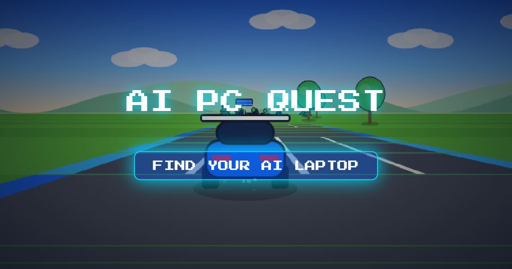

# AI PC Quest

**An interactive in-store kiosk that shows walk-in shoppers why an Intel AI PC is worth buying, then points them to the right laptop.**
Built for Intel's *1 Million Minds* hackathon, for retail floors like Croma and Reliance Digital.

Shoppers *feel* the difference before they read a spec sheet. They play a short mission on a "basic PC", unlock AI PC features one by one, and watch the problem disappear. Then a 30-second quiz turns their needs and budget into a real Intel AI laptop they can ask a store associate for.

- **Static site:** HTML, CSS and vanilla JS, with no build step and no framework.
- **Fully offline:** zero third-party requests. Three.js, the QR library and the fonts are all self-hosted.
- **Runs anywhere:** 1080p kiosk screens and phones in landscape, with a 2D fallback when 3D is too slow or unavailable.

<p align="center"></p>

---

## Contents

- [The experience](#the-experience)
- [Quick start](#quick-start)
- [Running it as a kiosk](#running-it-as-a-kiosk)
- [The three missions](#the-three-missions)
- [How the recommendation works](#how-the-recommendation-works)
- [Editing content](#editing-content)
- [Accuracy rules](#accuracy-rules)
- [Testing and debugging](#testing-and-debugging)
- [Project structure](#project-structure)
- [Credits and licences](#credits-and-licences)

---

## The experience

```
Landing ──▶ Missions ──▶ Quiz ──▶ Budget ──▶ Your AI processor ──▶ Laptops ──▶ Thank-you + QR
            │ Gaming (3D race)                        │
            │ Work   (metro inbox)                    └──▶ How it compares (side trip)
            │ Learning (study deadline)
            └─ finish at least one mission to unlock NEXT
```

| Screen | What the shopper sees |
|---|---|
| **Landing** | Intel logo, the *AI / PC / QUEST* title and one button. After 30 s untouched it plays a silent demo race (attract mode). |
| **Missions** | Three bouncing hex buttons. Each mission starts on a basic PC, hits a problem, and unlocks 3 AI PC features that fix it. |
| **Quiz** | "What will you use your PC for?" Multi-select: studying, work, entertainment, gaming, content creation, browsing. |
| **Budget** | Four price bands or a custom ₹ amount. |
| **Your AI processor** | The recommended Intel® Core™ Ultra chip, with key stats and "What AI does for you" lines picked from the quiz answers. If the ideal chip is over budget, one calm line explains the trade-off. |
| **Laptops** | Up to 3 real laptops with that chip, within budget. Tap a smaller card and it flies into the hero spot. |
| **How it compares** | Chip vs chip against the nearest competitor. Rows that matter to the shopper are highlighted, and sources are listed. |
| **Thank-you** | "Ask for the [laptop]" with SKU and price, plus a QR code that opens a phone card saying "Show this in store". |

Laptop names and recommendations appear **only after the quiz**. The missions speak about "Intel AI PC" in general.

---

## Quick start

Serve the folder over HTTP. The 3D race loads Three.js as an ES module, which browsers block on `file://`.

```bash
python3 -m http.server 8080
# open http://localhost:8080
```

### Deploy to GitHub Pages

1. Push this folder to the root of a GitHub repository.
2. **Settings → Pages → Build and deployment:** set *Deploy from a branch*, choose your branch and `/(root)`, and save.
3. After about a minute the site is live at `https://<you>.github.io/<repo>/`.

All paths are relative, so a sub-path works. `.nojekyll` makes Pages serve files as they are.
The link-preview image in `index.html` (`og:image`) points to `https://ayushv7.github.io/IntelXP/assets/og-image.png`. Change it if you host elsewhere.

---

## Running it as a kiosk

```bash
google-chrome --kiosk --autoplay-policy=no-user-gesture-required https://<you>.github.io/<repo>/
```

- **Fullscreen and sound:** buttons in the top-right corner. Sound is **muted by default**. All audio is synthesised with the Web Audio API, so there are no audio files.
- **No inactivity reset:** progress is never thrown away. It is also saved to `sessionStorage`, so an accidental refresh returns to the same screen with the same answers. A refresh in the middle of a mission returns to mission select. **↻ RESTART** on the thank-you screen starts over.
- **Attract mode:** after 30 s on the landing screen, an AI-driven car races silently at full AI PC quality. Any touch or key returns to the landing screen.
- **Leaderboard:** after the race, players enter 3 initials. Today's top 5 is shown on the results card and in attract mode. It is stored in `localStorage` and resets daily.
- **Haptics:** on phones, coins and crashes vibrate.
- **Accessibility:** `prefers-reduced-motion` tones down shakes, bounces, flashes and the popup animation. Focus rings appear on everything you can tap.

---

## The three missions

All three share one pattern: a counter at the top reads **"x/3 AI PC features unlocked"**. Each unlock pops up large in the centre, holds for about a second, then floats up and fades. The end screen lists the unlocked features in large type.

### Gaming: 3D race (`js/game.js`)

| Beat | What changes on screen | The hardware story |
|---|---|---|
| Start (≈8 s) | Boxy car, low-res render, simulated 15–20 FPS | "A normal computer" |
| Coin 1 | Frame cap removed | Intel Arc GPU renders more frames |
| Coin 2 | Full resolution with a wipe, detailed car, PBR lighting, shadows, reflections | Intel XeSS AI upscaling, running on the **GPU** |
| Congested zone (≈8 s) | Traffic, obstacles, intentional stutter | Background tasks interfere |
| Coin 3 | Stutter gone; bloom, neon, particles | Hybrid cores + Thread Director; the NPU takes AI extras at low power |

- **Car physics:** rigid-body collisions, typed traffic (hatchbacks to buses) with drivers who signal lane changes, and obstacles you can knock over.
- **Effects:** pooled particle effects (magnet coins, shockwave, sparks, tyre marks, dust, boost flame + heat haze, speed lines, blowing leaves), scaled by an automatic quality ladder.
- **Coaching:** a big "PRESS SHIFT TO BOOST" hint appears at the side, never over the road.
- **Safe for players:** the 3 upgrade coins are guaranteed and home in on the car. Collisions cost +1 s but never end the race.
- **Controls:** **W/↑** gas, **S/↓** brake, **A/D or ←/→** steer, **Shift/Space** boost, **Esc** exit. Phones get touch buttons and a "rotate your phone" prompt in portrait.
- **2D fallback (`js/race2d.js`):** same story, same HUD. It is used automatically when real FPS stays under 20 for 3 s or WebGL is missing.

### Work: inbox on a busy metro (`js/mini-work.js`)

Sort big email cards into **📁 IMPORTANT** or **🗑️ SPAM**. Work mail looks professional; spam looks obviously like spam. Each card carries a small AI hint badge, which is right most of the time but not always. Emails keep coming until the mission ends. The scenarios are time-based, with at least 8 s of normal play after each one:

1. **Battery drain:** the battery runs down fast and turns red. Flipping the *AI PC mode* toggle makes the drain very slow.
2. **Tunnel:** the internet drops and sorting stops. On-device AI keeps the hints coming offline.
3. **Noise:** passengers board and chatter builds. AI noise cancellation quiets the carriage without touching the battery.

About 5 s later the score appears: *"You sorted X of Y correctly (Z%)"*.

### Learning: assignment deadline (`js/mini-study.js`)

A pixel-art hostel room at 11:40 PM. Drag 3 lecture notes onto the laptop's web AI, then:

1. **Too slow:** unlock faster AI processing.
2. **TOKEN LIMIT REACHED:** choose *Pay ₹399 for subscription* (left) or *Pay ₹0 with Intel NPU* (right). Paying earns a playful "choose again". The NPU option switches to a clearly labelled local model.
3. **Power cut:** the room goes dark and the Wi‑Fi drops. Unlock offline AI and finish anyway.

---

## How the recommendation works

Everything is data-driven: there are no if/else ladders.

1. **Ideal tier:** `computeTier(picks)` in `js/app.js` takes the highest tier among the quiz picks (`tierRules` in `processors.js`). Three or more "everyday" picks move up to "pro".
2. **Budget:** `recommendWithBudget(picks, budget)` in `js/app.js` is a pure function over `js/laptops.js`:
   - If the ideal chip's cheapest laptop fits the budget, that chip wins.
   - Otherwise it picks the best chip that fits, never better than the ideal one, and shows a one-line trade-off: *"Your ideal match is the … It starts at about ₹… This is the best Intel AI laptop chip in your budget."*
   - If nothing fits, the shopper sees the most affordable chip and *"Intel AI laptops start at about ₹…"*.
3. **Laptops:** laptops with that chip within budget, ranked by how many of their tags match the picks (e.g. studying → `student`/`portable`). The list is topped up from the next chip down if there are fewer than 2. The first one is marked **MOST RECOMMENDED**.

Specs, the battery claim, Copilot+ feature lines and the comparison are shown only when they are true for that exact chip.

---

## Editing content

| What | Where |
|---|---|
| Quiz options, tier rules, chip specs, taglines, comparisons, sources | `js/processors.js` |
| Chips by budget, price bands, laptops (brand, SKU, RAM/storage, ₹ price, tags, "why it fits") | `js/laptops.js` |
| Every word in the Work and Study missions | the `TEXT` object at the top of `js/mini-work.js` and `js/mini-study.js` |
| Work mission pacing (calm time, battery drain, end delay) | `TEXT.timing` in `js/mini-work.js` |
| Race stage lengths | `COIN_S` and `CONG_START` at the top of `js/game.js` and `js/race2d.js` |

Prices change often. They are shown as *"₹price\*"* with *"\*Approx. price seen online, check in store"*. Re-check them and the stock before each event.

---

## Accuracy rules

These are deliberate and should be kept:

- The **FPS counter always shows real, measured frames**. Simulated effects (the frame cap and the stutter) are time-based, look the same on every device, and are labelled **SIMULATED** in the HUD.
- The **NPU is never credited with raising gaming FPS**. **XeSS is credited to the GPU.**
- Battery life is an Intel claim with a footnote. Laptops get an "All-day battery" badge, never a per-model hour figure.
- Copilot+ features carry *"Availability varies by region and Windows update."*
- Every mission screen says *Simulated demonstration*.
- Laptop names appear only after the quiz.

---

## Testing and debugging

| URL / console | Use |
|---|---|
| `?mode=2d` | Force the 2D race |
| `?mode=3d` | 3D only (disables the automatic 2D fallback) |
| `?debug=layout` | Outlines in red, and logs, every element that overflows its box, its parent or the viewport. Run `__layoutCheck()` again after navigating. |
| `?result=<tier>&model=<sku>` | The phone card the QR code opens |
| `__app` | App state, `show(screen)`, `recommendWithBudget(...)` |
| `__game` | Race debug: `debug` (state, stage, FPS), `_jump(metres)` |

---

## Project structure

```
index.html            all screens and overlays
css/styles.css        design system: tokens, cards/tiles/pills, hex buttons, HUD, screens, responsive
css/minigames.css     Work + Study mission styles
css/fonts.css         self-hosted font faces
js/processors.js      chips, quiz, tier rules, comparisons, sources
js/laptops.js         budget bands, chip prices, laptop catalogue
js/app.js             flow, quiz, budget, recommendation, chip/laptops/compare/end screens,
                      attract mode, leaderboard, QR share, progress save/restore
js/game.js            Three.js race (physics, traffic, FX, quality ladder) + HUD
js/race2d.js          2D canvas fallback race (same API and HUD)
js/boosthint.js       "PRESS SHIFT TO BOOST" coaching
js/sfx.js             Web Audio sound effects (muted by default)
js/minis.js           shared mission kit: HUD counter, dialogs, unlock popup, end page
js/mini-work.js       Work mission
js/mini-study.js      Learning mission
js/debug-layout.js    dev-only overflow checker (loaded by ?debug=layout)
js/vendor/three/      Three.js r160, only the files the game imports
js/vendor/qrcode/     qrcode-generator 1.4.4
assets/               Intel logo, generic chip art, favicon, link-preview image
fonts/                Inter, Space Grotesk, Press Start 2P (latin woff2)
```

---

## Credits and licences

- [Three.js](https://threejs.org/) r160: MIT
- [qrcode-generator](https://github.com/kazuhikoarase/qrcode-generator) by Kazuhiko Arase: MIT
- Fonts: Inter, Space Grotesk and Press Start 2P, under the SIL Open Font License 1.1
- Intel, the Intel logo, Intel Core, Intel Arc and XeSS are trademarks of Intel Corporation. Laptop brands and models belong to their owners. Prices and specifications are approximate and for demonstration.
